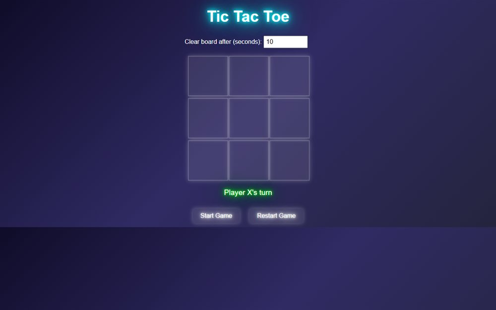

# Tic Tac Toe

A neon two-player Tic Tac Toe with an auto-clear timer, so a fresh round starts without touching the mouse.

**[Open the live site](https://ajeet-iitk.github.io/TicTacToe1.0/)**

## What it does

Two players, one board, no AI. X and O alternate on a 3x3 grid, and a configurable "clear board after N seconds" timer resets the round automatically - handy when you are playing a long series.

## Features

- Two-player local play with turn indicator
- Board drawn on `<canvas>` in a `requestAnimationFrame` loop
- Adjustable auto-clear delay (default 10 seconds)
- Start and restart controls

## Run locally

Open `index.html`, or play the hosted build:

<https://ajeet-iitk.github.io/TicTacToe1.0/>

## Files

| File | Purpose |
| --- | --- |
| `index.html` | Landing page |
| `tictactoe11.html` | The game |

---

Part of [my collection of small projects](https://github.com/Ajeet-iitk).
